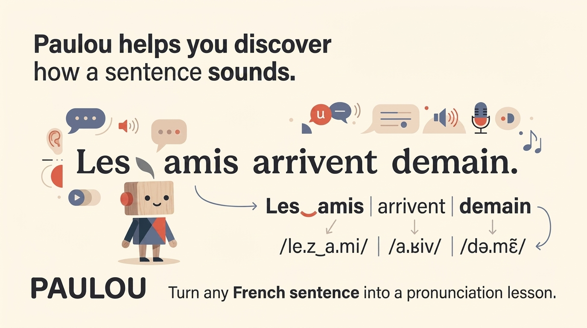

# Paulou



A French pronunciation practice app: users input any sentence they want to practice — not just pre-scripted content — and the app breaks it down into rhythmic chunks, then into word- and phoneme-level units, with liaison-aware guidance and speech assessment feedback at each level.

**Status: working local prototype.** You can type a sentence, listen to a reference voice (normal or slow), record yourself, and see sound by sound what was said correctly, replaced, added or missing. Scores are not meaningful yet: the calibration statistics from a native corpus do not exist, so the app shows no numeric score (see [Current status](#current-status)).

---

## Why Paulou

Most pronunciation apps (Duolingo, Babbel, ELSA Speak) only let users practice sentences the app already provides. Paulou lets users type in *their own* sentences — a presentation script, a real conversation they need to prepare for, a sentence they got wrong last week — and get the same level of structured practice as if it were curated content.

Two design bets follow from that:

- **Liaison as a first-class citizen.** French liaison (the way word-final consonants resurface before a following vowel, e.g. *les amis* → /le.z‿a.mi/) is one of the hardest things for learners to internalize, and most tools treat it as a footnote in feedback text rather than something structurally modeled and drilled. Paulou treats a liaison pair as its own unit of practice and scoring, distinct from single-word units.
- **Custom speech assessment instead of an off-the-shelf API.** Commercial pronunciation-scoring APIs (Azure Pronunciation Assessment was evaluated first) don't expose a way to control the phoneme sequence being scored against, and their French support lacks phoneme-level detail (no `NBestPhonemes`, no syllable breakdown for `fr-FR`). Liaison specifically is a known weak point even by Microsoft's own admission. Paulou instead builds a custom phoneme-level scoring pipeline — a single free-decode + 3-way alignment pass (Decision Log D36) — with full control over the reference phoneme sequence, so liaison can be scored deliberately rather than hoped for.

See [Key design decisions](#key-design-decisions) for the reasoning behind each major choice, with links to the experiments backing them.

---

## Quick start

Needs Docker Desktop, the Lexique400 file and a Gemini API key. Full instructions (and the two-process development setup) are in [docs/web_app.md](docs/web_app.md).

```bash
# from the package directory (the one containing docker-compose.yml)
# 1. put Lexique400.tsv in data/        (git-ignored, downloaded separately — see SETUP.md)
# 2. put GEMINI_API_KEY=... in the .env one level above the package (the repo root; copy .env.example)
docker compose up --build
```

Then open **http://localhost:8080** (use `localhost`: browsers only allow the microphone on `localhost` or https). The first start downloads the speech model; loading it takes about 12 seconds after the container is up, and the page says so and unlocks recording when it is ready.

How a session goes:

1. Type or paste a French sentence. Preparing it (splitting into rhythm groups and recording a reference voice) takes roughly 3.5–16 seconds, longer for longer sentences.
2. Pick a chunk and listen to it, at normal speed or slowly. Pick one unit (a word, a liaison pair, an elided clitic) to drill it alone.
3. Record. The result is the expected sounds in order, each marked *said correctly*, *said as another sound*, *extra sound* or *missing*, plus a written comment. Scoring takes well under a second per chunk.

---

## Architecture

```
User input (sentence)
        │
        ▼
[1] Sentence Parser        — splits into rhythmic chunks (groupe rythmique)
        │
        ▼
[2] Chunk Analyzer         — G2P, liaison rules, assembles PronunciationUnits
        │
        ▼
[3] TTS                    — one synthesis pass per sentence, sliced by timestamp
        │
        ▼
[4] Practice UI            — chunk-level and unit-level drilling
        │                     (React frontend → FastAPI backend → PaulouPipeline)
        ▼
[5] Speech Assessment      — single free-decode + 3-way alignment pipeline
                              (Decision Log D36)
```

| Stage | Folder | What it does |
|---|---|---|
| Sentence parsing | [`stages/parsing/`](stages/parsing/) | LLM-based chunking into rhythmic groups (Gemini API, D27), with an on-disk cache by sentence text so chunking is stable and repeat sentences skip the LLM call (`caching.py`, D55) |
| G2P | [`stages/chunk_analyzer/g2p/`](stages/chunk_analyzer/g2p/) | Word → phonemes (Lexique400 + eSpeak-ng fallback, D30) |
| POS tagging | [`stages/chunk_analyzer/pos/`](stages/chunk_analyzer/pos/) | Needed to apply liaison rules correctly |
| Liaison rules | [`stages/chunk_analyzer/liaison/`](stages/chunk_analyzer/liaison/) | Obligatoire / interdite / facultative rule engine |
| Elision detection | [`stages/chunk_analyzer/elision/`](stages/chunk_analyzer/elision/) | Closed-list lookup for elided clitics (l', d', j', ...) — distinct from liaison, D28 |
| Unit assembly | [`stages/chunk_analyzer/assembly/`](stages/chunk_analyzer/assembly/) | Groups words into `single`, `liaison_group`, or `elision_group` `PronunciationUnit`s |
| TTS | [`stages/tts/`](stages/tts/) | Sentence-level synthesis with word-boundary timestamps — two swappable providers (Azure Neural, edge-tts, D31; edge-tts is the default), caching (D7), span location (`timing_alignment.py`, D48) and chunk/unit audio slicing (D5) |
| Speech Assessment | [`stages/speech_assessment/`](stages/speech_assessment/) | One free-phone-recognition pass per recording, 3-way Levenshtein alignment against the canonical phonemes (`align.py`, D38), per-op scoring (`scoring.py`, D39), per-unit merge (`merge.py`, D40), feedback text (`feedback.py`, D41), chunk orchestration (`speech_assessment.py::score_chunk`, D42). Real recognizers in `free_decode/` (`wav2vec2_cnam` is the default, D45/D47) |
| Pipeline | [`pipeline.py`](pipeline.py) | `PaulouPipeline`: `analyze_sentence`, `synthesize_reference`, `score_attempt`, `slice_reference` (D48); `core/config.py::PipelineConfig` selects implementations |
| Backend | [`backend/api/`](backend/api/) | FastAPI app that only calls `PaulouPipeline` (D13): `/api/health`, `/api/sentences`, `/api/sentences/{id}/audio`, `/api/attempts` (D54). Scoring is synchronous (D52); the speech model is loaded and warmed at startup |
| Frontend | [`frontend/`](frontend/) | Vite + React + TypeScript practice UI (D58). Shows the expected sounds in order, colour- and symbol-coded by outcome |

Every model-backed or externally-dependent stage (parser, G2P source, TTS provider, free-phone recognizer) is defined as a `Protocol` interface and resolved through a small registry, so alternative implementations can be swapped via config without touching the pipeline or other stages — this is what lets `stages/tts/azure_tts.py` and `edge_tts_provider.py` coexist (D31). The swappable interface for Speech Assessment is `FreePhoneRecognizer`: `decode(audio) -> tuple[list[str], list[float], list[tuple[int, int]]]` (phones, per-position confidence, per-position time boundaries; D37). Pure, deterministic logic (liaison rules, unit assembly, alignment, merging, calibration, feedback templates) is kept as plain functions — no abstraction layer, since there is no real expectation of swapping these.

The core pipeline (`core/`, `stages/`, `pipeline.py`) is plain Python with no dependency on any UI layer. It is callable directly from a notebook, the command line ([docs/pipeline_cli.md](docs/pipeline_cli.md)) or a test; the backend wraps it in a thin API, and the pipeline itself has no knowledge that a backend or frontend exists. API schemas are separate from the core data models (D14).

---

## Key design decisions

| Decision | Why | Backing |
|---|---|---|
| Custom phoneme-level pipeline instead of Azure Pronunciation Assessment | Azure gives no control over the reference phoneme sequence and lacks phoneme-level detail for `fr-FR`; liaison handling is unverifiable | — |
| Single free-decode + 3-way Levenshtein alignment (replacing an earlier GOP + free-decode two-branch design) | Substitution, insertion and deletion in one pass; faster to build and control, and it matches the pattern used by other open-source pronunciation tools (OpenPronounce, Echoic). The earlier two-branch design (GOP forced-align + free phone recognition) is superseded | D36 |
| Free-decode model chosen with a canonicalizer-bias check on a synthetic diagnostic set | An ASR-style recognizer may "correct" a dropped liaison back to the canonical form and hide the very error being taught. A residual bias near nasal vowels is documented | D10, D43–D47, [results](experiments/results/canonicalizer_bias/) |
| Liaison modeled as its own `PronunciationUnit` type, not a word-level footnote | Liaison is a resyllabification phenomenon — scoring and drilling it as two separate words loses the thing being taught | — |
| Unsupervised percentile/z-score calibration, not a supervised regressor | No labeled French pronunciation dataset exists (unlike English's speechocean762); building one is deferred until there is real usage data to justify it | D11 |
| Sentence-level TTS synthesis (not per-chunk or per-unit) | Preserves natural prosody and in-context liaison; chunks and units are sliced from one audio pass via timestamps, not synthesized separately | D5 |
| Rule-based liaison detection (not a learned model) | Sufficient for short user sentences; known to break down on unconstrained input (accepted, see below) | D4 |
| Scoring runs synchronously inside the request | Measured on one development machine (Windows, 16 logical CPUs, CPU only): 0.075–0.114 s median per chunk and at most 0.63 s (p90) for a 7 s sentence, far below the 1–2 s threshold. Sentence preparation is the slow step (up to about 16 s), so the UI shows a loading state | D52, [latency results](experiments/results/latency/RESULTS.md) |
| Local single-user web app, no auth, no database | Progress tracking is deferred; prepared sentences live in memory and the parse and TTS caches live on disk | D53 |
| Browser recordings are uploaded in their native format and converted to WAV with ffmpeg | `MediaRecorder` produces webm/opus in Chromium, which the recognizer's audio reader cannot open; checked on a real recording | D56 |
| No numeric scores until real calibration statistics exist | With placeholder statistics the numbers would look meaningful and not be; the UI shows the alignment ops and written feedback, and says that the overall wording is provisional | D57 |

---

## Current status

**Paulou runs end to end with real components** — Gemini, Lexique400 + eSpeak-ng, edge-tts, wav2vec2 — from the command line ([docs/pipeline_cli.md](docs/pipeline_cli.md)) and through the web app ([docs/web_app.md](docs/web_app.md)). The backend and frontend are tested with a stub pipeline plus a browser smoke test; the speech model itself is exercised only by the CLI, the diagnostic set and manual runs.

**Implemented so far** (decision numbers refer to the Decision Log; open items are in the [Roadmap](docs/roadmap.md)):
- **Pure functions**: liaison rule engine (`stages/chunk_analyzer/liaison/rule_engine.py`), elision detection (`.../elision/elision.py`, D28), unit assembly (`.../assembly/unit_assembler.py`), calibration (`stages/speech_assessment/calibration.py`), feedback templating (`feedback.py`, applied uniformly to every unit type since D32).
- **G2P + POS tagging**: `stages/chunk_analyzer/g2p/lexique_espeak.py` (Lexique400, D30, + eSpeak-ng fallback) and `.../pos/spacy_tagger.py` (spaCy `fr_core_news_sm`).
- **Sentence parser + TTS**: `stages/parsing/gemini_parser.py` (D27); two TTS providers — `azure_tts.py` and `edge_tts_provider.py` (D31) — plus `caching.py` (D7) and `audio_slicing.py` (D5).
- **Speech assessment, single-pipeline design** (D36–D42): `AlignmentOp` / `ScoredAlignmentOp` in `core/models.py` (replacing the dormant `RawPhoneScore` / `PhoneScore`, D37); `align.py` (3-way Levenshtein, D38), `scoring.py` (D39), `merge.py` (D40), `feedback.py` (D41), `speech_assessment.py::score_chunk` (D42). The earlier two-branch GOP + free-decode work (D33–D35) was superseded by D36 and is kept only as history.
- **Free-phone recognizers** (D45): `free_decode/` — `wav2vec2_cnam` (default) and `wav2vec2_bofenghuang`. **Diagnostic set and canonicalizer-bias check** (D43–D47): `experiments/diagnostic_set/`, `experiments/runners/`, `experiments/results/`.
- **Pipeline orchestration** (D48): `pipeline.py::PaulouPipeline`, `core/config.py::PipelineConfig`, `stages/tts/timing_alignment.py::locate_spans`. edge-tts hang fix and timing offset (D49); command-line runner (`experiments/runners/pipeline_cli.py`, D50); latency benchmark (D52).
- **Parse cache** (D55): `stages/parsing/caching.py::CachingSentenceParser`, enabled in `PaulouPipeline` through `parser_cache_dir`.
- **Web app** (D53–D58): `backend/api/` (FastAPI; settings, schemas, mappers, audio conversion, in-memory sentence store, health/sentences/attempts routers), `frontend/` (Vite + React + TypeScript), `docker-compose.yml`, `Dockerfile.backend`.
- **Tests**: fast unit suite (`tests/unit`), backend API suite with a stub pipeline (`tests/api`, includes a real browser-recorded webm fixture), frontend suite (Vitest + Testing Library) and a Chromium smoke test (`frontend/e2e/smoke.mjs`), model tests that need the real spaCy model, and contract tests that need real Gemini/Azure credentials — see `tests/README.md`. The edge-tts contract test needs no credential but is run separately.
<!-- TODO: fill in test counts from a fresh run of every suite -->

**Not done, and what it means for users:**
- **No calibration statistics yet** (D11, D24). `calibrate_score` takes a table of per-phone statistics from a native French corpus, which has not been produced. Until then the CLI and the backend use placeholder statistics, and the API returns no numeric score (D57). The structure of the result (which sounds matched, were replaced, added or missing) is meaningful; the overall wording ("good effort", "needs work") is not. Supply a real table with `PAULOU_PHONE_STATS_PATH` and the same fields fill in without code changes.
- **Findings from the first real runs** are still open (see the [Roadmap](docs/roadmap.md)): liaisons inside a chunk that the rule engine does not predict, and optional schwa counted as missing.
- **No progress tracking, accounts or deployment.** One user, one process.
- **No audio-timeline view** of the recording; only the canonical view (D37, D58).
- The Docker setup has been built and run by the author on one machine; recordings were verified only in Chromium (with a fake microphone) — Safari and Firefox are untested.

**Known data/tooling gaps:**
- `pipeline.py` wires Lexique400 (D30) through `stage_kwargs` (D48); the plain `LexiqueEspeakG2P` constructor still loads the small hand-written fixture. The 33 MB file is not committed (git-ignored); download it separately — see SETUP.md.

**Next up:** the native-corpus calibration run (MVP-blocking), the schwa decision and the in-chunk liaison diagnosis before user testing, collecting real learner recordings. The canonicalizer-bias diagnostic (D10) is done: see D47 for the result and its caveat.

**Known limitations (by design, not oversight):**
- Liaison detection is rule-based (`stages/chunk_analyzer/liaison/rule_engine.py`) and is expected to be incomplete on free-form input with rare vocabulary, proper nouns or borrowed words (D4).
- The POS tagger (spaCy `fr_core_news_sm`) mistags "content" (adjective, "happy") as `ADV`, so the "très/trop + ADJ" liaison pattern misses it.
- A liaison that crosses a chunk boundary (e.g. "enfants‿ont") is not modeled: a learner who links it correctly is shown a false "extra sound" (D51). The UI says so when an extra sound appears.
- Optional schwa is counted as missing, and the recognizer can hear an extra consonant after a nasal vowel (D47). The UI explains both next to the result.
- Sentences containing digits or symbols are rejected, because the voice reads them differently from how they are written; write them out as words.
- The reference voice comes from edge-tts, an unofficial service that can change or stop working without notice (D31). Clip boundaries use a fixed 50 ms timing offset that was checked by ear on one sentence (D49).
- French support in the underlying acoustic models generally lags English; the default recognizer (`Cnam-LMSSC/wav2vec2-french-phonemizer`) is community-maintained.

---

## Getting started (development)

```bash
# clone and install
git clone https://github.com/quynhkhanh96/paulou.git
cd paulou                                    # repo root (docs/, this README, SETUP.md, the paulou/ package)
pip install -r requirements-dev.txt
python -m spacy download fr_core_news_sm     # separate step — see SETUP.md if this fails
cp .env.example .env                         # then fill in GEMINI_API_KEY (Azure Speech key is optional) — see SETUP.md

# everything else runs from the package directory (no packaging / pip install -e . yet)
cd paulou

# backend tests — no network, no models
pip install -r backend/requirements-dev.txt
pytest tests/unit tests/api -v

# frontend tests
cd frontend && npm install && npm test && cd ..

# model-backed suite — loads the real spaCy model, slower
pytest tests/model -v -m model

# contract suite — calls the real Gemini + Azure APIs, needs credentials
pytest tests/contract -v --ignore=tests/contract/test_edge_tts_provider_contract.py

# edge-tts contract — no credential needed, run separately (see tests/README.md — can hang on restrictive networks)
pytest tests/contract/test_edge_tts_provider_contract.py -v
```

Run the web app without Docker (two terminals, from the package directory; details in [docs/web_app.md](docs/web_app.md)):

```bash
uvicorn backend.api.main:create_default_app --factory --port 8000
cd frontend && npm run dev                   # http://localhost:5173
```

Run the whole pipeline from the command line (analyze, reference audio, self-test, score a recording): [docs/pipeline_cli.md](docs/pipeline_cli.md).

Compare free-phone-recognizer candidates on the diagnostic set:

```bash
python -m experiments.runners.compare_free_decoder --recognizers wav2vec2_cnam wav2vec2_bofenghuang
```

Qualitative review notebooks (chunking quality, audio playback, alignment visualization) are planned under `experiments/notebooks/` — not yet built.

---

## Repo structure

```
Paulou/                                # repo root
├── docs/
│   ├── assets/
│   ├── pipeline_cli.md                # running the whole pipeline from the command line (D50)
│   ├── web_app.md                     # running and configuring the web app, API reference (D53–D58)
│   └── roadmap.md
├── README.md                          # this file
├── SETUP.md                           # local dev setup (venv, dependencies, running tests)
├── requirements-dev.txt
├── .env.example                       # GEMINI_API_KEY, AZURE_SPEECH_KEY/REGION — copy to .env at this same level
├── .gitignore
└── paulou/                            # the Python package; run everything from here
    ├── core/                          # data models, interfaces (Protocol), registry, PipelineConfig (D48)
    ├── stages/                        # one subfolder per pipeline stage, swappable implementations
    │   ├── parsing/                   # Gemini sentence parser (D27) + parse cache (D55)
    │   ├── chunk_analyzer/            # stage 2 sub-modules (D29): liaison/, elision/, assembly/, g2p/, pos/
    │   ├── tts/                       # Azure Neural + edge-tts, caching, slicing, timing_alignment.py
    │   └── speech_assessment/         # align, scoring, merge, feedback, calibration, score_chunk,
    │       └── free_decode/           #   and the wav2vec2 recognizers (D45)
    ├── pipeline.py                    # PaulouPipeline (D48)
    ├── backend/                       # FastAPI app (D54)
    │   ├── api/                       # main, routers/, schemas, mappers, settings, audio conversion, store
    │   └── requirements*.txt
    ├── frontend/                      # Vite + React + TypeScript (D58): src/, e2e/ (browser smoke test)
    ├── docker-compose.yml             # backend + frontend (D53)
    ├── Dockerfile.backend
    ├── data/                          # [git-ignored] Lexique400.tsv, cache/ (TTS and parse caches)
    ├── tests/
    │   ├── unit/                      # fast, no network, no models
    │   ├── api/                       # backend API tests with a stub pipeline
    │   ├── model/                     # slow, loads the real spaCy model
    │   ├── contract/                  # calls real Gemini / Azure / edge-tts
    │   └── fixtures/                  # g2p_golden.tsv, diagnostic_audio/, browser_recording.webm
    └── experiments/                   # diagnostic_set/, runners/ (pipeline_cli, benchmark_latency,
                                       #   compare_free_decoder, canonicalizer_bias_check), results/;
                                       #   notebooks/ not yet built
```

---

## Contributing

This is primarily a personal research and learning project, built alongside a PhD. Issues and PRs are welcome, but response times may be slow, especially through end of 2026. The TTS and speech-assessment components are where a collaborator would help most; start with [docs/pipeline_cli.md](docs/pipeline_cli.md), which shows the whole pipeline running.

---

## License

[Functional Source License (FSL)](https://fsl.software/) — converts automatically to Apache License 2.0 two years after each version's release. Source is public and free to read, use, and modify for non-competing purposes; see [LICENSE](LICENSE) for full terms.

---

## Acknowledgments & references

- [Lexique400](http://www.lexique.org/) — open French phonetic/lexical database (D30; supersedes the originally planned Lexique383)
- [eSpeak NG](https://github.com/espeak-ng/espeak-ng) — fallback grapheme-to-phoneme synthesis
- [Azure Neural TTS](https://azure.microsoft.com/en-us/products/ai-services/text-to-speech) — official TTS provider (D5/D6/D7)
- [edge-tts](https://github.com/rany2/edge-tts) — unofficial, no-API-key TTS provider, the default (D31)
- [Cnam-LMSSC/wav2vec2-french-phonemizer](https://huggingface.co/Cnam-LMSSC/wav2vec2-french-phonemizer) — free French phoneme recognition (default free decoder, D47)
- bofenghuang's wav2vec2 French phoneme CTC model — the compared alternative free decoder (`wav2vec2_bofenghuang`, D45)
- [Piper](https://github.com/rhasspy/piper) (MIT) — local TTS, used only to generate the diagnostic audio (D43)
- [OpenPronounce](https://github.com/Halleck45/OpenPronounce) and [Echoic](https://github.com/xialeistudio/echoic) — open-source pronunciation-assessment tools whose free-decode + alignment approach informed D36